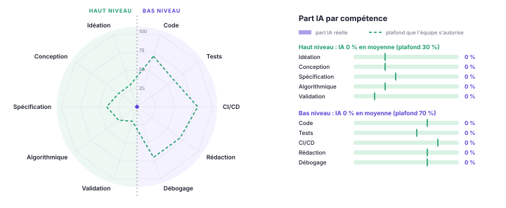

<!--
  Dossier de projet : 4 pages pour le dossier de lancement (R1), puis il s'enrichit à chaque livraison.
  Compilation : make -C doc   (pandoc + WeasyPrint ; mise en page dans style.css)
  Les commentaires HTML comme celui-ci n'apparaissent pas dans le PDF.
-->

# Équipe, comptes développeurs et dépôt

| Membre | Compte GitHub | Email des commits (`git config user.email`) |
|----------------------------|------------------------------|-----------------------------------------|
| Yasmine HADDAG | [`@yasminehdg`](https://github.com/yasminehdg) | `email`(haddagyasmine9@gmail.com) |
| Melissa AKLI | [`@Melissa-akli25`](https://github.com/Melissa-akli25) | `email`(melissa.akli2025@gmail.com) |
| Kenza CHAHNAZ | [`@0Kenza0`](https://github.com/0Kenza0) | `email`(kenzachahnaz@outlook.fr) |
| Daniel BADOYAN | [`@DanielBadoyan`](https://github.com/DanielBadoyan) | `email`(43003965@parisnanterre.fr) |
| Hélios LOTT | [`@helioslt`](https://github.com/helioslt) | `email`(helioslott@gmail.com) |

Chaque membre a vérifié que son email Git est associé à son compte GitHub, pour que ses commits lui soient bien attribués. **Dépôt** : <https://github.com/Melissa-akli25/Projet-PRJ> · **page de projet** : à compléter.

# Projet et caractère innovant

### Le problème

L'idée de **StudentConnect** est née de la situation rencontrée à l'Université Paris Nanterre, notamment des blocages et des perturbations qui ont pu empêcher le déroulement normal des enseignements et entraîner des changements d'organisation, comme le passage de certains cours à distance. Dans ces périodes, les étudiants peuvent rencontrer plusieurs difficultés : suivre les informations, trouver des espaces où travailler, accéder à des ressources utiles, continuer à réviser et travailler avec d'autres étudiants.

**StudentConnect** est une plateforme d'entraide et d'organisation destinée aux étudiants. Elle vise à faciliter la continuité du travail universitaire en regroupant plusieurs services : mise en relation entre étudiants de différentes universités, recherche de matières équivalentes, recherche d'espaces de travail, partage de ressources pédagogiques autorisées, demandes d'entraide et signalement des difficultés rencontrées à l'université.

### Ce qui est innovant

**Une réponse à une situation concrète** Le projet part des difficultés observées à Nanterre et cherche à apporter des solutions pratiques lorsque les cours ou l'organisation universitaire sont perturbés.
**Une ouverture interuniversitaire** La mise en relation ne se limite pas aux étudiants d'un même établissement. Elle peut s'appuyer sur les formations, les matières et les compétences pour identifier des étudiants qui travaillent sur des contenus proches.
**Des fonctionnalités qui produisent un résultat** L'application ne se limite pas à publier et consulter des informations : elle compare des matières, calcule des correspondances, regroupe des signalements, évalue leur priorité et oriente les demandes d'entraide.
**Des ressources partagées dans le respect du droit d'auteur** Les étudiants peuvent partager leurs propres fiches de révision et référencer des ressources accessibles publiquement, en indiquant leur source. Les documents protégés ne sont pas reproduits ni redistribués sans autorisation.

### Ce qui différencie  StudentConnect

Les plateformes universitaires permettent de consulter des informations, d'accéder à des ressources ou de suivre ses cours. StudentConnect souhaite aller plus loin en combinant l'entraide entre étudiants, le partage de ressources et le suivi des difficultés universitaires.

L'objectif n'est donc pas seulement de faciliter l'accès aux informations, mais de *permettre aux étudiants de s'entraider, de maintenir la continuité de leurs études et de trouver des solutions ensemble, même entre différentes universités*.

# Scénarios d'usage

1. En tant qu'étudiant de Nanterre, je renseigne ma formation, mes matières et mes compétences. L'application me propose des étudiants d'autres universités qui suivent des matières ou des formations similaires, grâce à un matching multicritère.

2. En tant qu'étudiant qui recherche un équivalent à une matière, je renseigne son intitulé et son contenu. L'application compare les programmes renseignés et identifie les matières similaires dans d'autres universités.

3. En tant qu'étudiant qui ne peut pas travailler chez lui, je recherche une bibliothèque ou un espace de travail. L'application filtre les lieux selon ma localisation, les horaires et les équipements disponibles.

4. En tant qu'étudiant qui souhaite aider les autres, je publie une fiche de révision que j'ai créée ou je référence un lien vers une ressource publique. Les autres étudiants peuvent retrouver cette ressource par matière et par catégorie.

5. En tant qu'étudiant bloqué sur une matière, je publie une demande d'entraide. L'application permet de décrire ma difficulté et de l'associer à une matière et à des compétences recherchées.

6. En tant qu'étudiant qui souhaite réviser avec d'autres personnes, je renseigne mon niveau, mes matières et mes objectifs. L'application peut constituer un groupe de travail selon ces critères.

7. En tant qu'étudiant confronté à un blocage universitaire, je consulte un signalement déjà publié et je confirme que je rencontre le même problème. Le nombre de confirmations permet de mieux identifier les difficultés partagées.

8. En tant qu'étudiant qui consulte les signalements, je souhaite retrouver les déclarations qui concernent un même problème. L'application analyse les textes et regroupe les signalements similaires.

# Plan feature
Une feature a un effet sur **la BD, le back, l'API REST et le front**. Chaque feature est portée par **une seule personne** et repose sur **un algorithme** identifié.

| Version | Yasmine | Melissa | Kenza | Daniel | Hélios |
|-----|---------|---------|---------|---------|---------|
| **v0.1.0** 24/11 | F3 Recherche d'espaces de travail — filtrage multicritère | F1 Matching interuniversitaire — matching multicritère | F2 Équivalence des matières entre universités — calcul de similarité |F4 Partage de ressources pédagogiques — gestion et catégorisation des ressources | F5 Gestion des demandes d'entraide — gestion des demandes et des compétences associées|
| **v0.2.0** 08/12 | F8 Analyse des signalements universitaires — analyse textuelle et classification | F6 Constitution de groupes de travail — répartition multicritère | F7 Confirmation des blocages — comptabilisation des confirmations | F9 Évaluation de la gravité des blocages — système de scoring|F10 Suivi des signalements — gestion des statuts et historique |
| **v1.0.0** 19/01 | F13 Alertes automatiques par e-mail — déclenchement automatique des notifications | F11 Recommandation personnalisée de ressources — système de recommandation par score | F12 Planification intelligente des révisions — algorithme d'ordonnancement | F14 Répartition des demandes d'entraide — affectation multicritère | F15 Tableau de bord des difficultés étudiantes — analyse statistique et visualisation |

# Architecture

Le front transmet les demandes à l'API REST. Le back exécute les règles métier et les algorithmes (matching entre étudiants, recherche de matières similaires, constitution de groupes de travail, analyse des signalements), accède à la base de données, puis renvoie les résultats au front au format JSON. L'API REST est intégrée à l'application Spring Boot.

| Couche | Choix | Remarques |
|--|-----|-----|
| Front | React, JavaScript, HTML/CSS | création et gestion des profils étudiants, recherche de ressources et d'espaces de travail, consultation des groupes et des signalements ; client de l'API REST uniquement ; dossier `front/` |
| API REST | Spring Web (Spring Boot), OpenAPI / Swagger UI | échanges HTTP et JSON ; versionnée sous `/api/v1` |
| Back | Java, Spring Boot, Spring Data JPA, Hibernate, Bean Validation | règles métier et algorithmes ; **algorithmes en Java pur, indépendants de Spring** |
| BD | MySQL (H2 pour les tests) | étudiants, universités, formations, matières, ressources pédagogiques, espaces de travail, demandes d'entraide, groupes de travail et signalements ; schéma versionné par **Flyway** |
| Qualité | JUnit 5, JaCoCo, SonarCloud | intégration continue GitHub Actions |
| Conteneurs | Docker Compose | BD dès v0.1.0, application en v0.2.0 |

**Qualité du code.** Au-delà de l'architecture :

- **Clean Code** : noms métier explicites, fonctions courtes, pas de duplication, commentaires qui expliquent le *pourquoi* ;
- **SOLID**, objets valeur immuables et invariants vérifiés à la construction ;
- **design patterns** quand ils servent, nommés dans les fiches de features ;
- conventions **REST** et règles de sécurité **OWASP** ;
- *quality gate* SonarCloud au vert.

# Démarche pour chaque feature

Les étapes s'enchaînent **dans cet ordre, sans en sauter** : on ne commence une étape que lorsque la précédente est terminée.

| Étape | Ce qu'on fait | Terminé quand |
|--|--------|-----|
| 1. Idéation | Besoin et scénario ; **algorithme retenu**, complexité, alternatives ; impact sur le schéma et l'API ; critères d'acceptation. Issue + fiche `doc/features/`. | La fiche est validée par un autre membre. |
| 2. Back | Migration Flyway ; **domaine** en Java pur (modèle, règles métier, algorithme de matching, similarité, classification ou scoring selon la feature) ; **application** (ports, services) ; adaptateur de persistance. | Le code compile et ArchUnit passe. |
| 3. Tests | Tests unitaires des algorithmes (cas limites, invariants, propriétés) ; tests des services avec de faux adaptateurs ; tests d'intégration de la persistance. | `./gradlew build` passe ; chaque critère d'acceptation est couvert. |
| 4. API REST | Endpoints `/api/v1`, DTO validés, erreurs `problem+json`, documentation OpenAPI ; tests de l'API. | Visible dans Swagger UI ; tests de l'API verts. |
| 5. Front | Développement des interfaces React qui consomment **uniquement** l'API REST : profils étudiants, recherche, ressources, entraide et signalements selon la feature. | Scénario jouable de bout en bout ; PR relue ; fiche complétée avec son araignée. |

# Protocole d'usage de l'IA

Principes fondamentaux à appliquer pendant tout le long de ce projet :

- Vérifier au maximum les résultats qui vont nous être donnés par les intelligences artificielles que nous serons amenés à utiliser.
- Chaque prompt devra être réfléchi et notre utilisation de l'IA devra être intelligemment pilotée afin de ne pas perdre le fil de notre travail et des algorithmes/codes que nous serons amenés à écrire.
- Interdiction d'inclure du code qu'on ne comprend pas et de confier à l'IA des données personnelles.

| Activité | Ce que fait l'IA | Ce que fait l'humain |
|---|-----|-----|
| Recherche du sujet et conception des objectifs du projet | Aide l'humain dans son choix des fonctionnalités à inclure, notamment par rapport à la pertinence vis-à-vis des consignes et pour éviter de faire un projet type « interface d'une simple base de données ». | Trouver le sujet du projet et réfléchir aux fonctionnalités techniques et algorithmiques qui pourraient être incluses. |
| Algorithmes | Aide à comprendre les algorithmes de matching, de similarité, de classification et de scoring. Elle peut également vérifier le fonctionnement du code, l'annoter et proposer des améliorations. | Rassemble les attentes de rendu des algorithmes puis les conçoit et les écrit en prenant en compte leur complexité. |
| Code technique (API, configuration, front) | Peut générer certaines parties, notamment les fonctions les plus complexes, et aider à comprendre les choix techniques. | Relit chaque ligne générée et compile avant d'adapter le code en fonction des besoins pour répondre au sujet. |
| Tests | Suggère les cas de test les plus courants, notamment pour les algorithmes de matching, de constitution des groupes et d'analyse des signalements. | Définit les propriétés, vérifie les tests effectués et adapte les propositions de l'IA en fonction de l'avancée du projet. |
| Débogage et revue | Propose des diagnostics et des pistes de résolution des bugs persistants. | Analyse les erreurs et corrige en conséquence. |

Afin d’assurer une traçabilité de l’usage de l’IA dans notre projet, les codes entièrement générés seront annotés en conséquence avec la précision des technologies utilisées et le niveau d’utilisation (l’écriture complète étant le niveau le plus élevé et la simple demande de recommandations ou de perspectives d’amélioration étant plus faible).

# Annexe : part IA / part humaine {#annexe-part-ia}

{.araignee}

Valeurs dans `doc/part-ia.json`, régénérées à chaque compilation. <!-- Commenter honnêtement les dépassements de plafond. -->
